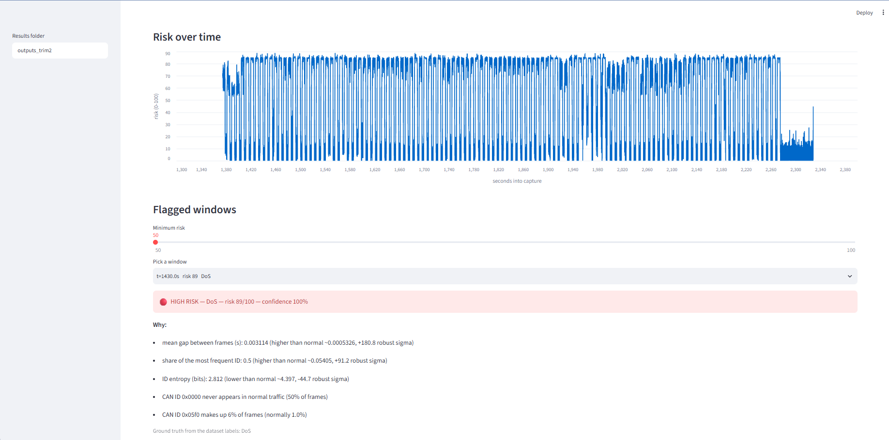
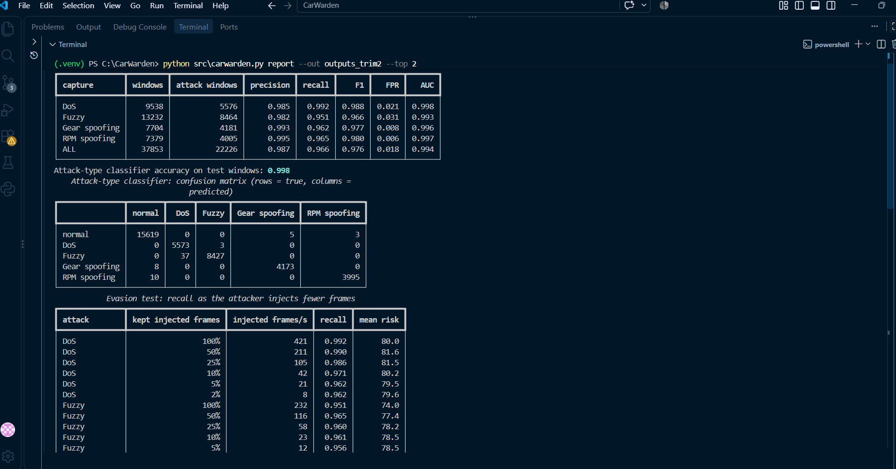
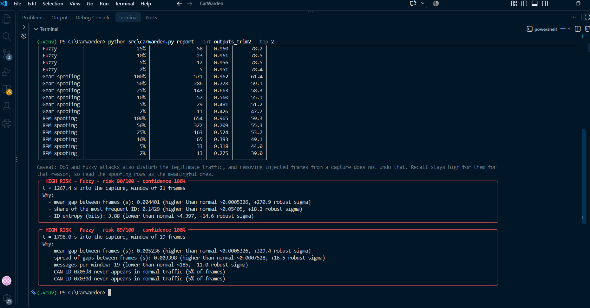
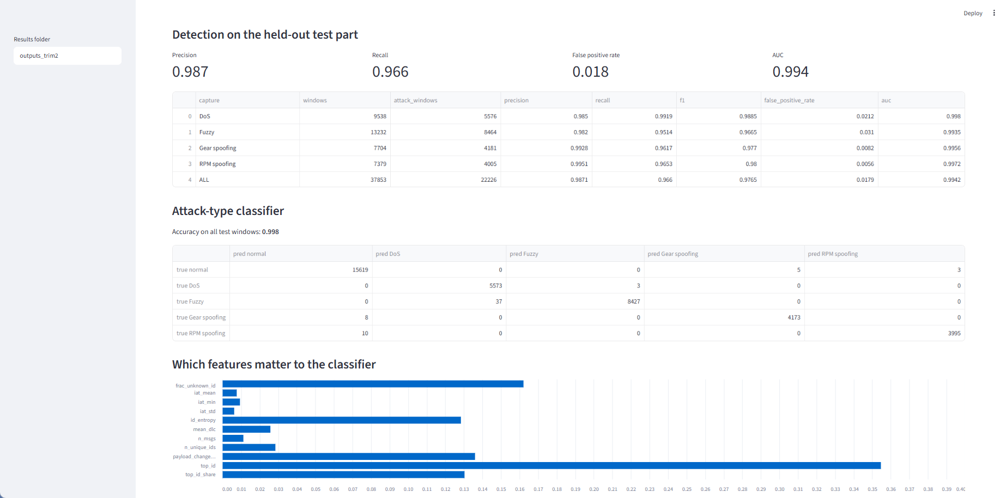
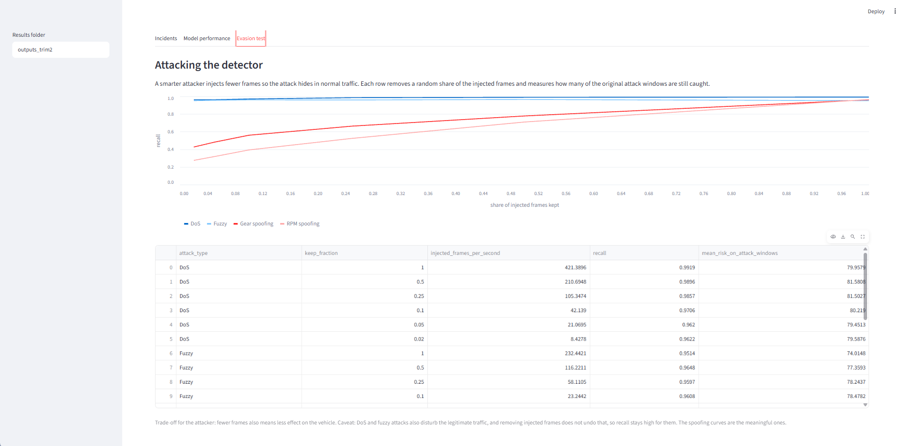

# CarWarden: AI security analyst for in-vehicle CAN networks


CarWarden watches the traffic on a vehicle's CAN bus, flags suspicious time windows, names the
likely attack type, and explains why. It then attacks its own detector to measure how robust it is.

Built as the successor to SentryNet (same pattern: unsupervised detector, 0-100 risk score,
two-layer explanation, Rich CLI, honest evaluation), applied to automotive data.

> **Status:** Phase 1 (detector, explanation, attack classifier, CLI, dashboard) and a first Phase 2
> experiment (evasion by lowering the injection rate) are implemented and tested.
> Phase 3 (LLM analyst) is future work.





## What it does

1. **Loads** the HCRL Car-Hacking captures (DoS, fuzzy, gear spoofing, RPM spoofing).
2. **Windows** each capture (default 0.1 s) and computes 10 features per window: message count,
   distinct IDs, ID entropy, share of the top ID, inter-arrival time mean/std/min, mean payload
   length, payload change rate for repeated IDs, and the share of frames with an ID never seen in
   normal traffic.
3. **Detects** anomalies with an Isolation Forest trained on **normal windows only**. The raw score is
   mapped to a 0-100 risk score; 50 is the alert threshold, calibrated on held-out normal windows
   (target false-positive rate 1%).
4. **Classifies** flagged windows with a Random Forest (DoS / Fuzzy / Gear spoofing / RPM spoofing).
   It uses the 10 features plus the dominant CAN ID of the window (`top_id`), which the detector does
   not see. A flagged window the classifier calls "normal" is reported as "unknown anomaly".
5. **Explains** each flagged window in two layers: (1) numeric features far from normal (robust
   z-score), (2) CAN IDs that are new or far more frequent than normal.
6. **Shows** results in a Rich terminal report and a Streamlit dashboard.
7. **Red-teams itself:** removes a growing share of the injected frames ("low and slow" attacker) and
   measures recall.

## Quick start (PowerShell)

```powershell
python -m venv .venv
.venv\Scripts\Activate.ps1
python -m pip install -r requirements.txt
python -m pytest                                              # 54 tests

python src\carwarden.py demo                                  # whole pipeline on synthetic data
python src\carwarden.py train --data-dir data --trim-gap 10   # real HCRL files in data\
python src\carwarden.py scan data\DoS_dataset.csv             # score one capture
streamlit run src\app.py                                      # dashboard (reads outputs\)
```

For the dashboard on other results: `$env:CARWARDEN_OUT="outputs_demo"; streamlit run src\app.py`

Real data: download the HCRL Car-Hacking dataset (see Credits) and put `DoS_dataset.csv`,
`Fuzzy_dataset.csv`, `gear_dataset.csv`, `RPM_dataset.csv` in `data\`. The data is not included in
this repository. `normal_run_data.txt` is not used (different format, different session).

`python src\carwarden.py demo` needs no download: it generates synthetic CAN captures.

## Results

**Real HCRL data, trimmed at the timing gap** (`train --trim-gap 10`, time-split test part):
overall precision 0.987, recall 0.966, false-positive rate 0.018, AUC 0.994. These are the numbers to
quote. The untrimmed run gives a better-looking false-positive rate (0.008) only because the appended
attack-free tail adds many easy normal windows (see Limitations).

| Capture | Precision | Recall | FPR | AUC |
|---|---|---|---|---|
| DoS | 0.985 | 0.992 | 0.021 | 0.998 |
| Fuzzy | 0.982 | 0.951 | 0.031 | 0.993 |
| Gear spoofing | 0.993 | 0.962 | 0.008 | 0.996 |
| RPM spoofing | 0.995 | 0.965 | 0.006 | 0.997 |



**Attack-type classifier:** accuracy 0.998 on the test windows (0.910 before the `top_id` feature
was added, when Gear and RPM spoofing were often confused). Gear spoofing is labeled correctly in
4173 of 4181 windows and RPM spoofing in 3995 of 4005. The classifier relies on the dominant CAN ID
of a window, so this number is specific to this dataset and vehicle and does not show that attack
types would be told apart on another car.

**Evasion (spoofing only, the meaningful rows):** recall falls from 0.96 to 0.43 (Gear) and from
0.97 to 0.28 (RPM) when only 2% of the injected frames are kept, about 11-13 injected frames per
second. The detector mostly reacts to the extra frame rate, so a low-rate spoofer can slip through.
For DoS and fuzzy the curve stays flat for a reason that says nothing about robustness (see
Limitations).



Synthetic demo data (`carwarden.py demo`) gives near-perfect scores. That only shows the code works;
the synthetic attacks are far easier than real ones and say nothing about real vehicles.

## Evaluation design

- **Time split:** each capture is cut at the time by which 60% of its injected frames have occurred.
  Everything before the cut trains, everything after tests, so no test window overlaps the training
  period. (A cut at 60% of the wall-clock duration put *all* attacks of the Fuzzy, Gear and RPM
  captures into training in the first full run, leaving no attacks to test on. The pipeline now
  refuses to run if either side has no attack windows.) The detector never sees attack windows.
- **Threshold calibration** uses held-out normal windows (last 20% of the normal training windows),
  not the windows the forest was fitted on.
- A window counts as an attack window if it contains at least one injected frame.
- **Trimming:** `--trim-gap 10` drops everything after the first gap longer than 10 s between two
  frames (see Limitations for why).

## Limitations (read before quoting any numbers)

- **Dataset quality.** Independent analysis of the HCRL Car-Hacking dataset (the ROAD dataset paper,
  arXiv 2012.14600) reports that the car was not driven during the attack captures, and recommends
  trimming the captures at a timing gap. We confirmed the gaps with `src/capture_info.py`
  (they start at about 2328, 2466, 1949 and 1952 s, matching the paper's trim marks), so the
  attack-free tail after the gap is a different state that lands in the test part as normal windows.
  Use `--trim-gap 10` to drop everything after the first gap longer than 10 s. CarWarden learns
  "normal" from the normal frames *inside* each capture (avoiding the driving-vs-parked mismatch),
  but that means it models one operating state and will not generalize to normal driving.
- **The HCRL attack files share one appended tail.** The last frames of `DoS_dataset.csv` and
  `Fuzzy_dataset.csv` are identical (same timestamps, IDs and bytes), and `--trim-gap 10` removes the
  same 891,068 frames from all four files. It is one attack-free recording appended to each capture.
  Untrimmed, that recording appears four times in the test sets and flatters the false-positive rate.
- **The false-positive rate (1.8%) is above the 1% calibration target.** The threshold is calibrated
  on normal traffic from the first part of each capture; later normal traffic drifts slightly.
- **`top_id` is dataset-specific.** The attack-type classifier uses the dominant CAN ID of a window to
  separate Gear from RPM spoofing; it would need retraining for another vehicle.
- **Easy attacks.** These attacks are very visible in bus timing and ID statistics; strong results on
  them do not show the detector would catch stealthy attacks.
- **Top incidents are mostly bus disturbance.** The highest-risk windows are sparse windows (about 20
  frames instead of about 185) in the fuzzy capture, where the bus went quiet. The explanations
  describe that disturbance accurately, but only a small share of those frames are the injected ones.
- **Window size and labeling are choices** (0.1 s, any injected frame = attack window). Results change
  with them.
- **Evasion test is one simple attacker:** random removal of injected frames. It is not adaptive or
  gradient-based. Fewer injected frames also means less effect on the vehicle, so "evading" has a cost
  for the attacker. For DoS and fuzzy attacks the curve is not meaningful: deleting injected frames
  does not undo the disturbance they caused, so recall stays high. Only the spoofing curves count.
  A cleaner test would inject synthetic frames into attack-free traffic (future work).
- **Explanations are deviation-based**, not causal and not SHAP values.
- **The classifier only knows the four attack types it was trained on.**
- **Synthetic tests** validate code correctness, not real-world performance.

## Project layout

```
src/data.py          parse_line, load_data (reference), load_frames (fast loader)
src/features.py      windowing, the 10 detector features, top_id for the classifier
src/detector.py      Isolation Forest + 0-100 risk score
src/explain.py       two-layer explanation
src/classifier.py    Random Forest attack-type classifier
src/evaluate.py      precision / recall / F1 / FPR / AUC, confusion matrix
src/evasion.py       low-and-slow evasion test
src/pipeline.py      load -> trim -> split -> train -> evaluate -> evasion -> save
src/carwarden.py     command line (demo, train, scan, report)
src/report.py        Rich output
src/app.py           Streamlit dashboard
src/synth.py         synthetic CAN data for tests and the demo
src/capture_info.py  summary of one capture (bursts, gaps, tail)
src/inspect_data.py  quick look at a raw file
src/check_files.py   check that the data files parse
src/diagnose.py      diagnostic: where the false alarms and missed attacks are
tests/               pytest suite (54 tests)
docs/HOW_IT_WORKS.md
```

## Future work

- Rebuild the evasion test by injecting synthetic frames into attack-free traffic at a controlled
  rate, so DoS and fuzzy results become meaningful too.
- Phase 3: LLM-based incident reports (retrieval over security documentation), then attack that layer
  (prompt injection through retrieved text).
- Stronger evasion attacks (mimicry of normal timing, payload crafting, data poisoning).
- Per-ID rate features, SHAP-based explanations; other datasets (ROAD, can-train-and-test).

## Credits

- Dataset: HCRL Car-Hacking Dataset, Hacking and Countermeasure Research Lab (Korea University),
  released "for academic purposes" (https://ocslab.hksecurity.net/Datasets/car-hacking-dataset).
  The data is not part of this repository; download it from the HCRL page.
  Please cite the authors' work if you use it:
  - H. M. Song, J. Woo, H. K. Kim, "In-vehicle network intrusion detection using deep convolutional
    neural network", Vehicular Communications 21 (2020) 100198.
  - E. Seo, H. M. Song, H. K. Kim, "GIDS: GAN based Intrusion Detection System for In-Vehicle
    Network", 2018 16th Annual Conference on Privacy, Security and Trust (PST), IEEE (corrected
    version: arXiv:1907.07377).
- Dataset critique: Verma et al., "A comprehensive guide to CAN IDS data and introduction of the ROAD
  dataset", arXiv:2012.14600.

## License

The code is released under the MIT license (see `LICENSE`). The HCRL dataset is not covered by it and
is not included; see Credits for its terms.